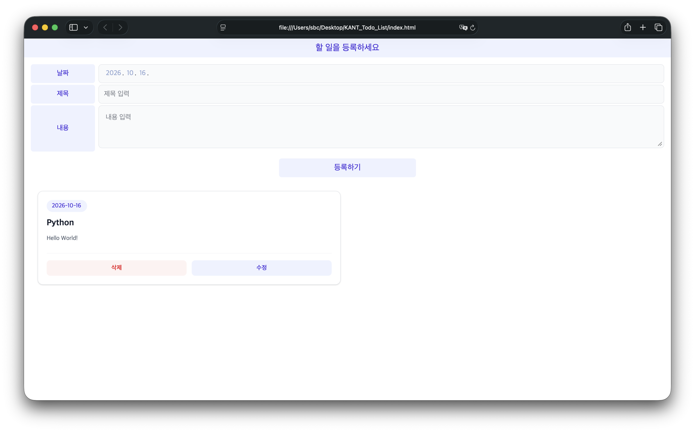

# KANT Todo List

HTML, CSS, JavaScript로 만든 할 일 관리 웹 애플리케이션입니다. 날짜, 제목, 내용을 입력해 할 일을 등록하고, 카드 목록에서 수정하거나 삭제할 수 있습니다. 데이터는 브라우저의 `localStorage`에 저장됩니다.

## 실행 화면



## 주요 기능

- **할 일 등록**: 날짜, 제목, 내용을 입력해 새 할 일을 추가합니다.
- **입력값 검사**: 등록·수정 시 필수 항목이 비어 있으면 안내 메시지를 표시합니다.
- **날짜순 정렬**: 할 일을 날짜가 빠른 순서대로 표시합니다.
- **할 일 수정**: 수정 팝업에서 기존 날짜, 제목, 내용을 변경합니다.
- **할 일 삭제**: 카드의 삭제 버튼으로 해당 항목을 즉시 삭제합니다.
- **데이터 유지**: 같은 브라우저와 접속 주소에서는 새로고침 후에도 저장된 목록을 불러옵니다.
- **반응형 카드 목록**: 화면 너비에 따라 한 열 또는 두 열로 배치하고, 내용의 줄바꿈을 유지합니다.

## 사용 기술

| 기술 | 용도 |
| --- | --- |
| HTML5 | 등록 폼, 카드 템플릿, 수정용 `dialog` 구성 |
| JavaScript | 입력값 검사, 등록·수정·삭제, 날짜 정렬, 화면 갱신 |
| Tailwind CSS v4 | CDN으로 불러오는 유틸리티 클래스 기반 스타일링 |
| Web Storage API | `localStorage`를 이용한 데이터 저장 및 복원 |

## 실행 방법

별도의 패키지 설치나 빌드 과정 없이 실행할 수 있습니다. `dialog`와 `localStorage`를 지원하는 최신 브라우저를 사용하세요. Tailwind CSS를 CDN에서 불러오므로 스타일을 정상적으로 표시하려면 인터넷 연결이 필요합니다.

### 파일을 직접 열기

프로젝트 폴더의 `index.html`을 브라우저로 엽니다.


## 사용 방법

1. **날짜**, **제목**, **내용**을 입력하고 **등록하기**를 누릅니다. 세 항목은 모두 필수이며, 입력값 앞뒤의 공백은 제거됩니다.
2. 등록된 할 일을 날짜순으로 확인합니다.
3. 카드의 **수정**을 누르면 기존 값이 채워진 팝업이 열립니다. 내용을 변경한 뒤 **수정 저장**을 누릅니다.
4. 변경 사항을 저장하지 않으려면 **취소**를 누르거나 `Esc` 키로 팝업을 닫습니다.
5. 카드의 **삭제**를 누르면 별도의 확인 창 없이 해당 할 일이 삭제됩니다.

## 프로젝트 구조

```text
KANT_Todo_List/
├── index.html       # 등록 폼, 카드 템플릿, 수정 팝업 및 Tailwind CSS 연결
├── css/
│   └── style.css    # 사용자 정의 스타일용 파일 (현재 비어 있음)
├── js/
│   └── todo.js      # 데이터 처리, 저장, 렌더링 및 이벤트 처리
├── Todo_list.png    # 실행 화면 이미지
└── README.md
```

## 데이터 저장 방식

할 일 목록은 `localStorage`의 `todos` 키에 JSON 배열로 저장됩니다. 각 항목은 다음 속성을 가집니다.

| 속성 | 설명 |
| --- | --- |
| `uid` | 등록 시 `Date.now()`로 생성한 식별값 |
| `date` | `YYYY-MM-DD` 형식의 날짜 |
| `title` | 할 일 제목 |
| `content` | 할 일 내용 |

등록·수정·삭제 시 목록을 저장하고 화면을 다시 그립니다. 페이지를 열 때는 저장된 목록을 읽어 날짜 오름차순으로 표시합니다.

